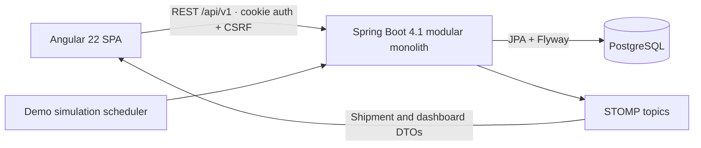
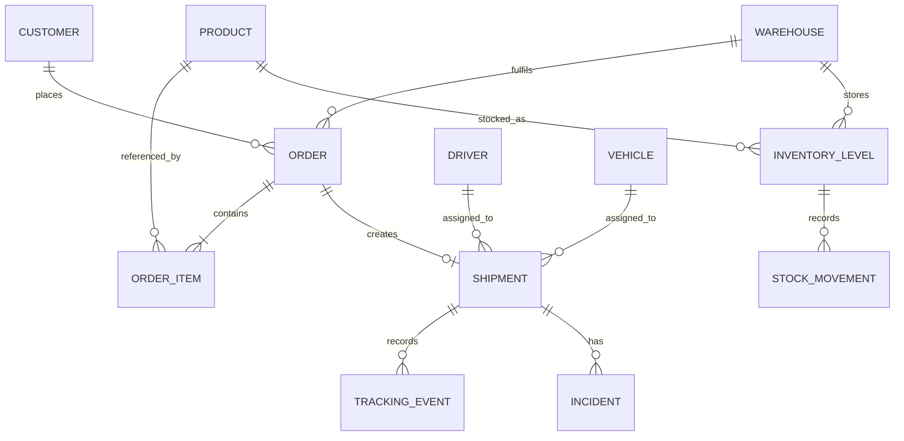

# Mazmi Logistics Control

A full-stack logistics operations platform for managing orders, inventory, shipments, fleet, incidents and simulated real-time tracking.

> **Functional portfolio/demo application.** Mazmi Logistics Control does not represent a real company. All customers, contacts, drivers, licence numbers, registration plates, products, orders, positions and operational events in the demo environment are fictional. Tracking is an internal deterministic simulation; the application does not consume private logistics information or real GPS data.

## Overview

The application models one coherent workflow rather than a collection of unrelated CRUD screens:

`Customer → Draft order → Stock reservation → Preparation → Shipment → Fleet assignment → Dispatch → Simulated tracking → Delivery`

The backend owns prices, stock balances, permissions and state transitions. PostgreSQL constraints and transactional services protect the same invariants enforced by the application layer.

## Key Features

- Role-based login for `ADMIN`, `OPERATOR` and `VIEWER` users.
- Draft order creation with customer address snapshots and server-owned product prices.
- Atomic stock reservation, release and dispatch with an immutable movement ledger.
- Explicit order and shipment state transitions; arbitrary status updates are not exposed.
- Driver and vehicle assignment with availability, uniqueness and capacity checks.
- Large Leaflet shipment map using OpenStreetMap tiles and a clearly labelled simulated route.
- Deterministic backend simulation with STOMP updates, milestone events and automatic delivery at 100%.
- Operational incidents that affect delivery health and ETA, with a resolution workflow.
- Aggregated dashboard endpoint with KPIs, seven-day volume, critical inventory and live map items.
- Paginated and filtered operational lists.
- Idempotent demo seeding with current relative timestamps and internally consistent stock.
- OpenAPI, Actuator health, Docker topology and GitHub Actions validation.

## Demo Flow

1. Sign in as the operator.
2. Create a draft order and add active products.
3. Confirm it; stock becomes reserved in one transaction.
4. Start preparation and mark the order ready; a shipment is created.
5. Assign an available driver and a vehicle with sufficient capacity.
6. Start the shipment; reserved stock is dispatched and fleet resources become busy.
7. Start **Simulated tracking** and watch the marker, ETA, progress and timeline update without refresh.
8. Simulate a traffic incident; delivery health changes to `DELAYED` and the ETA moves.
9. Resolve the incident, then continue the simulation.
10. At 100%, the shipment and order become delivered and the driver and vehicle return to available.

## Architecture



The source is organised by domain (`orders`, `inventory`, `shipments`, `fleet`, `incidents`, and so on) inside a modular monolith. See [docs/architecture.md](docs/architecture.md) for the main boundaries and security decisions.

## Technology Stack

| Layer | Technology |
| --- | --- |
| Frontend | Angular 22.1, TypeScript 6.0, standalone components, Signals, RxJS, Angular Material, SCSS |
| Realtime and visualisation | STOMP WebSocket, Leaflet 1.9, OpenStreetMap, Chart.js 4.5 |
| Backend | Java 21, Spring Boot 4.1, Spring MVC, Spring Security, Spring Data JPA |
| Data | PostgreSQL 17, Flyway, UUID, `TIMESTAMPTZ`, optimistic locking |
| API and operations | springdoc-openapi 3, Actuator |
| Verification | JUnit 5, Mockito, Testcontainers PostgreSQL, Vitest, ESLint, Prettier, Spotless |
| Runtime | Node 24.15, Maven Wrapper, Docker Compose, Nginx |

## Data Model



The detailed field and invariant notes are in [docs/data-model.md](docs/data-model.md).

## Real-Time Simulation

Only `IN_TRANSIT` shipments can start the demo simulation. Every five seconds the backend advances a deterministic progress value, interpolates a curved display path between the warehouse and the order's destination snapshot, recalculates position and ETA, and publishes a small DTO to `/topic/shipments/{id}` and `/topic/dashboard`.

Milestone events are stored at 25%, 50% and 75%; a database row is not written for every tick. The display route is not presented as a road route and no geocoding or mapping API key is required.

## Roles & Permissions

| Capability | ADMIN | OPERATOR | VIEWER |
| --- | :---: | :---: | :---: |
| Read operational data | Yes | Yes | Yes |
| Orders, stock, shipments, fleet and incidents | Yes | Yes | No |
| User administration | Yes | No | No |

Angular guards hide unavailable actions for a clearer experience. Spring Security method authorization remains the enforcement boundary.

## API

- Base URL: `http://localhost:8080/api/v1`
- Swagger UI when `SWAGGER_ENABLED=true`: `http://localhost:8080/swagger-ui.html`
- OpenAPI JSON when `SWAGGER_ENABLED=true`: `http://localhost:8080/v3/api-docs`
- Health: `http://localhost:8080/actuator/health`
- WebSocket handshake: `ws://localhost:8080/ws`

Important endpoints use business verbs such as `/orders/{id}/confirm`, `/shipments/{id}/start` and `/incidents/{id}/resolve`. Errors use a stable structure containing HTTP status, business code, message, path, timestamp and field errors.

## Running with Docker

Requirements: Docker with Compose v2.

```bash
cp .env.example .env
```

Set a strong local database password and a random `JWT_SECRET` of at least 32 characters in `.env`. The example intentionally leaves both values empty so an unchanged configuration fails fast instead of starting with predictable credentials. Then run:

```bash
docker compose up --build
```

Open `http://localhost:4200`. PostgreSQL persists in the named `postgres_data` volume. Stop the stack with:

```bash
docker compose down
```

Use `docker compose down -v` only when you intentionally want to remove all local demo database data.

The Compose defaults enable fictional demo data and Swagger. Set `DEMO_ENABLED=false`, use a non-demo Spring profile and set `SWAGGER_ENABLED=false` when you want an empty, documentation-disabled environment. Set `COOKIE_SECURE=true` whenever the application is served over HTTPS.

## Local Development

Requirements: Java 21 and a Node version supported by Angular 22 (`.nvmrc` pins Node 24.15.0).

Create the local environment file, fill in `POSTGRES_PASSWORD` and `JWT_SECRET`, export it into the current shell and start PostgreSQL:

```bash
cp .env.example .env
set -a
source .env
set +a
docker compose up -d postgres
```

In that same terminal, start the backend:

```bash
cd backend
SPRING_PROFILES_ACTIVE=demo ./mvnw spring-boot:run
```

In a second terminal:

```bash
nvm use
cd frontend
npm ci
npm run start
```

The Angular development proxy forwards `/api` and `/ws` to port 8080, so application code always uses relative URLs.

## Demo Accounts

These accounts exist only when demo seeding is enabled.

| Role | Email | Password |
| --- | --- | --- |
| ADMIN | `admin@mazmilogistics.test` | `Demo2026!` |
| OPERATOR | `operator@mazmilogistics.test` | `Demo2026!` |
| VIEWER | `viewer@mazmilogistics.test` | `Demo2026!` |

Passwords are stored as BCrypt hashes. Demo users are not created when the demo flag/profile is disabled.

## Testing

Frontend:

```bash
cd frontend
npm ci
npm run format:check
npm run lint
npm run test
npm run build
```

Backend:

```bash
cd backend
./mvnw spotless:check
./mvnw verify
```

PostgreSQL integration and constraint tests use Testcontainers and require a running Docker daemon; the build fails rather than silently skipping them when Docker is unavailable.

## CI

`.github/workflows/ci.yml` runs separate frontend and backend jobs on GitHub-hosted Linux runners. Formatting, lint, unit/integration tests and builds are required to pass.

## Project Structure

```text
frontend/                 Angular application and Nginx image
backend/                  Spring Boot modular monolith and Flyway migrations
docs/                     Architecture and data model notes
.github/workflows/ci.yml  Validation pipeline
docker-compose.yml        PostgreSQL, backend and frontend topology
```

## Roadmap

- Partial shipments and warehouse transfers
- Advanced route planning backed by a real routing provider
- CSV/PDF operational exports
- Notification centre
- Browser-level end-to-end test suite
- Richer analytics and vehicle maintenance workflows

## License

Released under the [MIT License](LICENSE).
