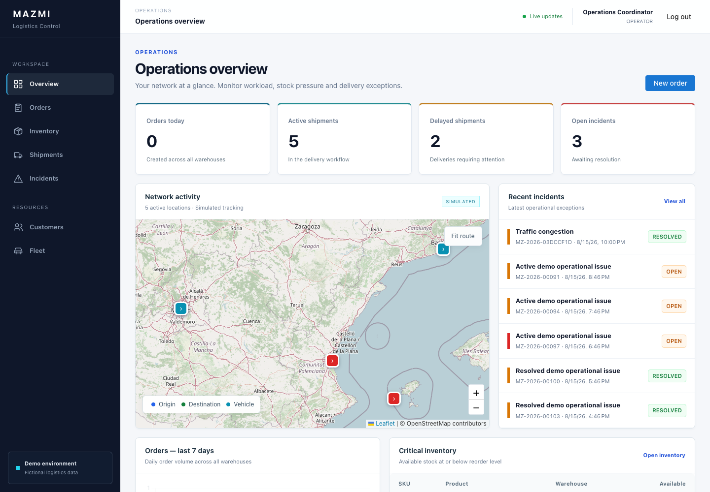
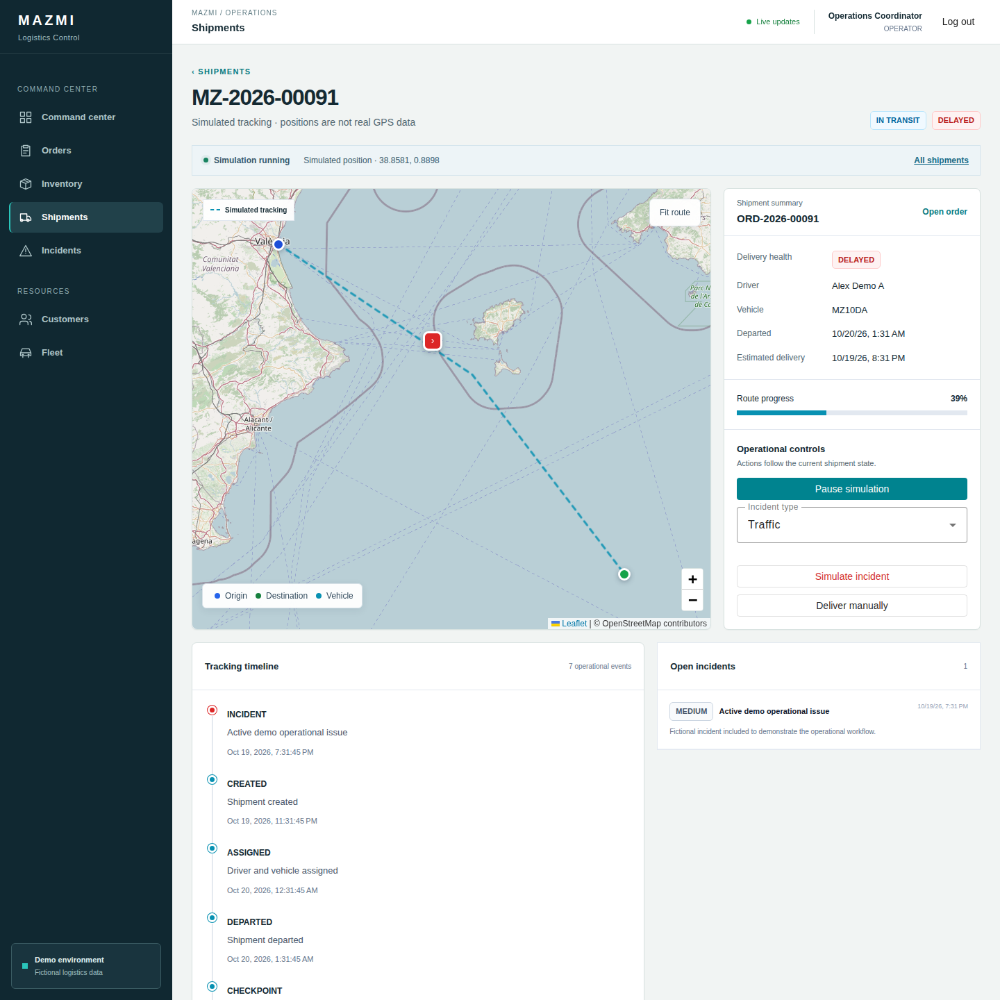
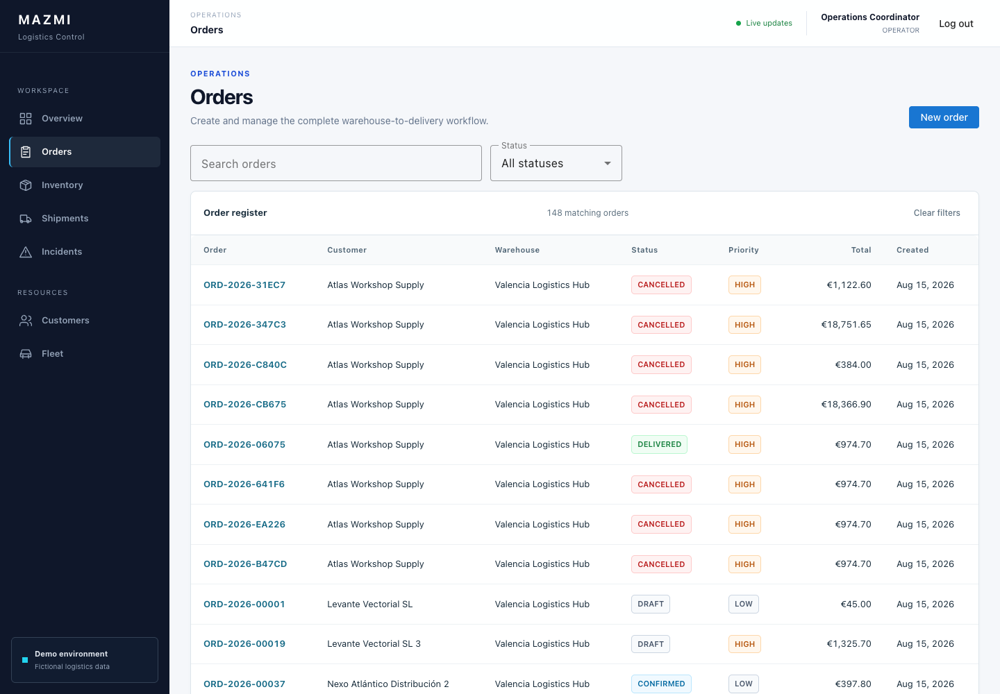
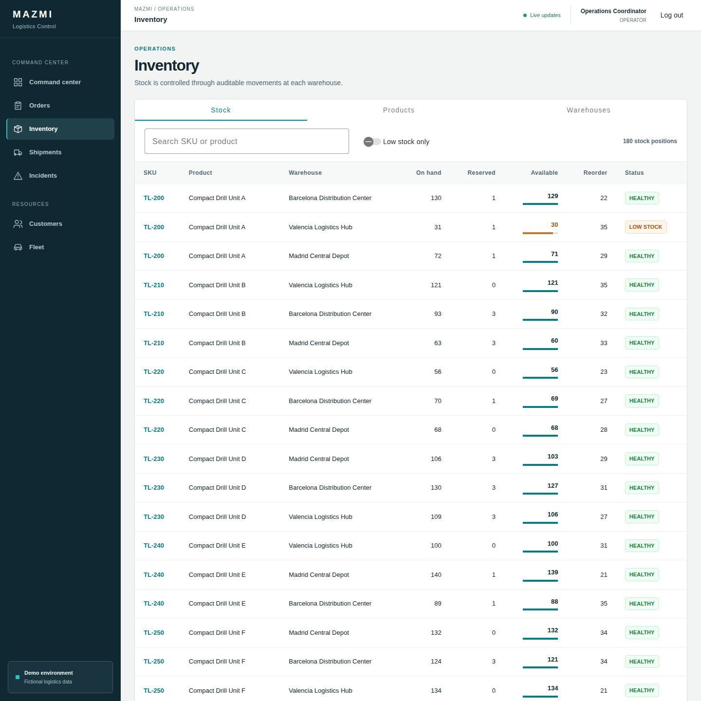
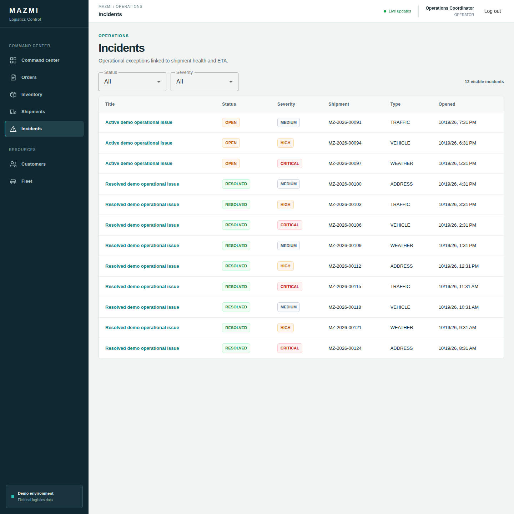
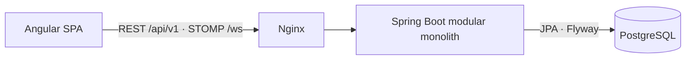

# Mazmi Logistics Control

[](https://github.com/LucaMZM/mazmi-logistics-control/actions/workflows/ci.yml)


<br>


Plataforma full-stack de operaciones logísticas para coordinar pedidos, inventario, envíos, flota, incidencias y seguimiento simulado en tiempo real desde un único panel.

## Índice

- [Descripción](#descripción)
- [Capturas](#capturas)
- [Problema que resuelve](#problema-que-resuelve)
- [Flujo principal](#flujo-principal)
- [Funcionalidades](#funcionalidades)
- [Roles](#roles)
- [Stack técnico](#stack-técnico)
- [Arquitectura](#arquitectura)
- [Instalación con Docker](#instalación-con-docker)
- [Usuarios demo](#usuarios-demo)
- [API y WebSocket](#api-y-websocket)
- [Tests y CI](#tests-y-ci)
- [Estructura del proyecto](#estructura-del-proyecto)
- [Documentación](#documentación)
- [Próximas mejoras](#próximas-mejoras)
- [Autor](#autor)
- [Licencia](#licencia)

## Descripción

Mazmi Logistics Control representa una operación logística conectada de principio a fin. Los pedidos de clientes se relacionan con almacenes, productos y existencias; su confirmación reserva stock, la preparación genera un envío y la salida coordina inventario, conductor, vehículo y eventos de seguimiento.

La aplicación no plantea estos módulos como CRUD independientes. El backend controla precios, permisos, transiciones de estado y movimientos de stock para mantener un flujo operativo coherente entre todas las áreas.

Los datos del perfil demo son ficticios. Las posiciones de los envíos se calculan mediante una simulación interna y no proceden de dispositivos GPS reales.

## Capturas

### Visión operativa



### Seguimiento simulado de envíos



<table>
  <tr>
    <td width="33%"><br><strong>Pedidos</strong></td>
    <td width="33%"><br><strong>Inventario</strong></td>
    <td width="33%"><br><strong>Incidencias</strong></td>
  </tr>
</table>

## Problema que resuelve

Una operación logística necesita coordinar información que suele quedar repartida entre sistemas o registros separados:

- pedidos de clientes y direcciones de entrega;
- almacenes, productos y niveles de inventario;
- reservas de stock y movimientos posteriores;
- preparación y expedición de pedidos;
- asignación de conductores y vehículos;
- seguimiento del envío y estimación de entrega;
- incidencias operativas y su resolución;
- confirmación final de la entrega.

Mazmi Logistics Control reúne este ciclo en una única aplicación y mantiene la relación entre cada decisión operativa y sus efectos sobre pedidos, inventario, envíos y flota.

## Flujo principal

`Cliente → Pedido → Reserva de stock → Preparación → Envío → Asignación de flota → Salida → Seguimiento → Entrega`

Un pedido nace como borrador con precios obtenidos del catálogo del servidor. Al confirmarlo, el backend reserva todas sus líneas dentro de una transacción. Cuando la preparación termina, se crea el envío; al iniciar la ruta, el stock reservado se despacha y los recursos de flota pasan a estar ocupados. La entrega actualiza conjuntamente pedido, envío, conductor y vehículo.

Las transiciones se exponen como acciones de negocio explícitas. Las transacciones de Spring, las restricciones de PostgreSQL, el historial de movimientos y el bloqueo optimista del inventario protegen la consistencia durante todo el flujo.

## Funcionalidades

### Dashboard

- KPIs de pedidos del día, envíos activos, envíos retrasados e incidencias abiertas.
- Volumen de pedidos de los últimos siete días.
- Inventario crítico y últimas incidencias.
- Mapa de envíos activos con estado de entrega y progreso simulado.
- Endpoint agregado para evitar múltiples consultas independientes desde el frontend.

### Pedidos

- Creación de pedidos en estado borrador con cliente, almacén, prioridad y dirección de entrega.
- Precios de producto y totales calculados por el backend.
- Listado paginado, filtros y vista de detalle.
- Transiciones explícitas de confirmación, preparación y pedido listo.
- Cancelación controlada con liberación de reservas cuando corresponde.
- Creación automática del envío al completar la preparación.

### Inventario

- Existencias por producto y almacén.
- Cálculo de disponibilidad como `on_hand - reserved`.
- Recepciones y ajustes mediante operaciones controladas.
- Reserva, liberación y expedición vinculadas al pedido.
- Historial inmutable de movimientos de stock.
- Restricciones de integridad y bloqueo optimista para evitar balances inválidos.

### Envíos

- Creación, asignación, salida, entrega y cancelación según el estado permitido.
- Asignación de conductor y vehículo con validaciones de disponibilidad y capacidad.
- Expedición transaccional del inventario reservado.
- Estado operativo separado de la salud de entrega: `ON_TIME`, `AT_RISK` o `DELAYED`.
- Historial cronológico de eventos de tracking.

### Seguimiento simulado

- Simulación iniciable y pausable para envíos en tránsito.
- Actualización periódica de progreso, posición y ETA.
- Ruta visual entre almacén y destino sobre un mapa Leaflet.
- Checkpoints persistidos en hitos operativos.
- Actualizaciones en tiempo real mediante STOMP/WebSocket.
- Entrega automática al alcanzar el 100 % del recorrido simulado.

### Flota

- Gestión de conductores y vehículos.
- Estados de disponibilidad sincronizados con los envíos.
- Validación de recursos activos, asignaciones concurrentes y capacidad del vehículo.
- Liberación automática de conductor y vehículo al completar la entrega.

### Incidencias

- Listado y detalle de incidencias asociadas a envíos.
- Tipos operativos como tráfico, vehículo, meteorología o dirección.
- Impacto sobre la salud de entrega y la ETA.
- Resolución con nota, fecha y eventos de seguimiento asociados.

### Seguridad

- Autenticación stateless mediante JWT firmado en cookie `HttpOnly`.
- Protección CSRF compatible con Angular y cookies `SameSite`.
- Autorización por rol aplicada en el backend.
- CORS limitado al origen configurado.
- Precios, actores y estados de negocio controlados por el servidor.
- Contraseñas almacenadas como hashes BCrypt.

## Roles

| Rol        | Permisos principales                                                                                                                     |
| ---------- | ---------------------------------------------------------------------------------------------------------------------------------------- |
| `ADMIN`    | Consulta y gestiona la operación logística completa. También administra usuarios y contraseñas.                                          |
| `OPERATOR` | Consulta los datos operativos y gestiona pedidos, inventario, envíos, flota, incidencias y catálogos logísticos. No administra usuarios. |
| `VIEWER`   | Acceso autenticado de solo lectura a los datos operativos. No puede ejecutar mutaciones.                                                 |

Los guards de Angular adaptan la interfaz al rol, mientras que Spring Security constituye la barrera efectiva de autorización.

## Stack técnico

| Área             | Tecnologías                                                            | Uso dentro del proyecto                                    |
| ---------------- | ---------------------------------------------------------------------- | ---------------------------------------------------------- |
| Frontend         | Angular 22.1.1 · TypeScript 6.0.3                                      | SPA, navegación y componentes de la consola logística.     |
| Interfaz         | Angular Material 22.1.1 · SCSS                                         | Formularios, tablas y sistema visual responsive.           |
| Reactividad      | Angular Signals · RxJS 7.8.2                                           | Estado de la interfaz y flujos asíncronos.                 |
| Mapas y gráficos | Leaflet 1.9.4 · OpenStreetMap · Chart.js 4.5.1                         | Mapa de envíos e indicadores del dashboard.                |
| Tiempo real      | STOMP.js 7.3.0 · WebSocket                                             | Actualizaciones de seguimiento y dashboard.                |
| Backend          | Java 21 · Spring Boot 4.1.0                                            | API y reglas de negocio en un monolito modular.            |
| Seguridad        | Spring Security 7.1.0 · JJWT 0.12.6                                    | Roles, JWT en cookie HttpOnly y protección CSRF.           |
| Persistencia     | PostgreSQL 17 · Spring Data JPA · Hibernate ORM                        | Datos transaccionales y control del inventario.            |
| Migraciones      | Flyway 12.4.0                                                          | Evolución versionada del esquema de base de datos.         |
| API              | REST `/api/v1` · springdoc-openapi 3.0.3                               | Endpoints de negocio y documentación OpenAPI.              |
| Pruebas          | Vitest 4.1.11 · JUnit Jupiter · Mockito 5.23.0 · Testcontainers 1.21.4 | Pruebas de frontend, backend e integración con PostgreSQL. |
| Entorno          | Node.js 24.15.0 · npm 11.12.1 · Docker Compose                         | Instalación y builds reproducibles.                        |
| Servidor web     | Nginx 1.30.5                                                           | Sirve la SPA y actúa como proxy de API y WebSocket.        |
| CI               | GitHub Actions                                                         | Formato, análisis estático, pruebas y builds.              |

## Arquitectura



El frontend es una SPA Angular servida por Nginx. Las peticiones REST bajo `/api/v1` y la conexión WebSocket `/ws` se redirigen al backend Spring Boot. La persistencia utiliza Spring Data JPA sobre PostgreSQL, con un esquema creado y versionado exclusivamente mediante Flyway.

El backend mantiene una arquitectura monolítica modular organizada por dominios: autenticación, usuarios, clientes, almacenes, productos, inventario, pedidos, flota, envíos, incidencias, simulación y dashboard. Los controladores trabajan con DTOs y los servicios concentran las reglas transaccionales y las transiciones de estado.

Más detalle en [Arquitectura](docs/architecture.md) y [Modelo de datos](docs/data-model.md).

## Instalación con Docker

### Requisitos

- Docker con Docker Compose v2.
- Puertos locales `4200`, `8080` y `5432` disponibles.

### 1. Clonar el repositorio

```bash
git clone https://github.com/LucaMZM/mazmi-logistics-control.git
cd mazmi-logistics-control
```

### 2. Preparar el entorno

```bash
cp .env.example .env
```

Antes de iniciar los contenedores, configura en `.env`:

| Variable            | Requisito                                                |
| ------------------- | -------------------------------------------------------- |
| `POSTGRES_PASSWORD` | Contraseña local obligatoria para PostgreSQL.            |
| `JWT_SECRET`        | Secreto aleatorio obligatorio de al menos 32 caracteres. |

`.env.example` ya define el nombre de base de datos, usuario, perfil demo, origen local, Swagger y política de cookie apropiados para desarrollo. En un despliegue con HTTPS debe utilizarse `COOKIE_SECURE=true`.

### 3. Iniciar la aplicación

```bash
docker compose up --build
```

Compose crea PostgreSQL, espera a su healthcheck, inicia el backend y finalmente publica el frontend mediante Nginx ejecutado sin privilegios.

| Recurso      | URL                                                                            |
| ------------ | ------------------------------------------------------------------------------ |
| Aplicación   | [http://localhost:4200](http://localhost:4200)                                 |
| Swagger UI   | [http://localhost:8080/swagger-ui.html](http://localhost:8080/swagger-ui.html) |
| OpenAPI JSON | [http://localhost:8080/v3/api-docs](http://localhost:8080/v3/api-docs)         |
| Health       | [http://localhost:8080/actuator/health](http://localhost:8080/actuator/health) |

Para detener los servicios sin eliminar el volumen de PostgreSQL:

```bash
docker compose down
```

## Usuarios demo

Las siguientes cuentas se crean únicamente cuando el perfil y el seeder demo están habilitados. La contraseña común es `Demo2026!`.

| Rol        | Email                          | Alcance                                         |
| ---------- | ------------------------------ | ----------------------------------------------- |
| `ADMIN`    | `admin@mazmilogistics.test`    | Operación completa y administración de usuarios |
| `OPERATOR` | `operator@mazmilogistics.test` | Gestión de la operación logística               |
| `VIEWER`   | `viewer@mazmilogistics.test`   | Consulta de solo lectura                        |

## API y WebSocket

La API REST utiliza la base `/api/v1`, paginación en los listados operativos y acciones explícitas para las transiciones de negocio. Algunos endpoints representativos son:

| Método y ruta                                  | Operación                                 |
| ---------------------------------------------- | ----------------------------------------- |
| `POST /api/v1/orders/{id}/confirm`             | Confirmar el pedido y reservar stock      |
| `POST /api/v1/orders/{id}/start-preparation`   | Iniciar la preparación                    |
| `POST /api/v1/orders/{id}/mark-ready`          | Completar la preparación y crear el envío |
| `POST /api/v1/shipments/{id}/assign`           | Asignar conductor y vehículo              |
| `POST /api/v1/shipments/{id}/start`            | Despachar stock e iniciar el envío        |
| `POST /api/v1/shipments/{id}/simulation/start` | Iniciar el seguimiento simulado           |
| `POST /api/v1/incidents/{id}/resolve`          | Resolver una incidencia                   |

El endpoint STOMP es `ws://localhost:8080/ws`. Durante la simulación, el backend publica actualizaciones compactas en:

- `/topic/shipments/{id}`: detalle en tiempo real de un envío;
- `/topic/dashboard`: actualizaciones para el mapa y los indicadores operativos.

La autenticación WebSocket utiliza la misma cookie JWT que la API.

## Tests y CI

### Frontend

```bash
cd frontend
npm ci
npm run format:check
npm run lint
npm run typecheck
npm run test
npm run build
```

La suite utiliza Vitest para servicios, autenticación, guards, manejo HTTP, formularios, acciones de pedidos y actualizaciones WebSocket.

### Backend

```bash
cd backend
./mvnw spotless:check
./mvnw verify
```

El backend combina JUnit Jupiter, Mockito y tests de integración contra PostgreSQL real mediante Testcontainers. Se validan reglas de inventario, restricciones de base de datos, seguridad, transiciones, asignación de flota, capacidad y rollback transaccional.

El workflow de GitHub Actions ejecuta jobs independientes para frontend y backend con Node.js 24.15.0 y Java 21. Formato, lint, tests y builds forman parte de la validación automatizada.

## Estructura del proyecto

```text
mazmi-logistics-control/
├── frontend/                  Angular SPA y configuración Nginx
├── backend/                   Spring Boot, dominios y migraciones Flyway
├── docs/
│   ├── architecture.md        Decisiones y límites de arquitectura
│   └── data-model.md          Entidades, relaciones e invariantes
├── .github/workflows/ci.yml   Validación automatizada
├── docker-compose.yml         PostgreSQL, backend y frontend
└── .env.example               Variables locales sin secretos
```

## Documentación

- [Arquitectura del sistema](docs/architecture.md)
- [Modelo de datos e invariantes](docs/data-model.md)
- [Especificación OpenAPI](http://localhost:8080/v3/api-docs), disponible con el entorno demo en ejecución

## Próximas mejoras

- Envíos parciales y transferencias entre almacenes.
- Integración opcional con un proveedor real de rutas.
- Exportaciones operativas en CSV y PDF.
- Suite end-to-end de navegador y mayor cobertura de accesibilidad.

## Autor

**Luca Mazmishvili**

Desarrollador web · Valencia, España

## Licencia

Este proyecto se distribuye bajo la [licencia MIT](LICENSE).
