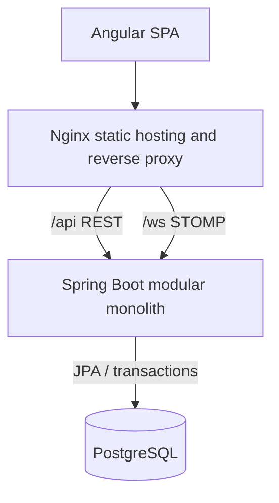

# Architecture

Mazmi Logistics Control is a modular monolith with a separate Angular single-page application.

## Backend boundaries

Packages follow the business domains: authentication, users, customers, warehouses, products, inventory, orders, fleet, shipments, incidents, simulation and dashboard. Controllers translate HTTP requests into DTOs; services own transitions and transactional rules; repositories own persistence queries. JPA entities are not returned directly by controllers.

Inventory mutations pass through `InventoryService`, update an optimistic-locked `InventoryLevel`, validate the resulting balance and write a `StockMovement`. Order confirmation reserves every line in a single transaction, so an insufficient line rolls back the entire reservation. Shipment departure dispatches the reserved stock and claims both fleet resources in the same operation.

## Backend as source of truth

The browser never supplies order prices, creator identities or arbitrary workflow states. Prices come from active products, actors come from the security context and transitions are exposed as explicit actions. PostgreSQL check, unique and foreign-key constraints provide a second integrity layer.

## Authentication and security

Spring Security signs a short-lived access JWT using an environment-provided secret and returns it in an HttpOnly, SameSite cookie. The browser does not persist the token in Web Storage. A readable `XSRF-TOKEN` cookie is paired with Angular's `X-XSRF-TOKEN` header for state-changing requests. Cookie security and the single allowed development origin are configurable.

Method authorization allows viewers to read, operators to run logistics workflows and administrators to manage users. The WebSocket handshake passes through the same cookie authentication filter.

## Realtime simulation

A scheduler advances only shipments that are both `IN_TRANSIT` and explicitly simulation-active. The position is deterministic between stored warehouse coordinates and the order destination snapshot. The scheduler writes checkpoint events only at business milestones and publishes compact update DTOs over STOMP. At 100%, it calls the same delivery service used by manual delivery.

## Docker topology

Compose starts PostgreSQL, waits for database health, starts the backend and then starts the Nginx frontend after Actuator reports healthy. Nginx serves the SPA, falls back to `index.html`, and proxies REST and WebSocket traffic to the backend.

The Compose demo defaults are explicit environment settings: demo seeding and Swagger can both be disabled without changing an image. Outside the demo profile, API documentation is disabled by default. HTTPS deployments must enable secure cookies and configure their exact browser origin.
