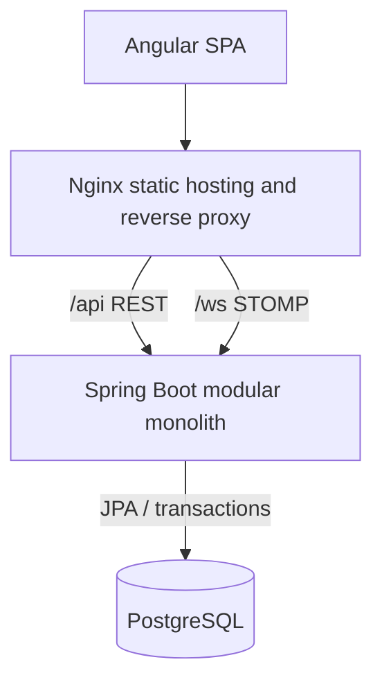

# Arquitectura

Mazmi Logistics Control es un monolito modular con una SPA Angular independiente.

## Límites del backend

Los paquetes siguen los dominios operativos: autenticación, usuarios, clientes, almacenes, productos, inventario, pedidos, flota, envíos, incidencias, simulación y dashboard. Los controladores trabajan con DTOs; los servicios mantienen las transacciones y transiciones; los repositorios concentran las consultas. Las entidades JPA no se devuelven directamente.

`InventoryService` valida los saldos, modifica `InventoryLevel` con bloqueo optimista y registra cada `StockMovement`. Confirmar un pedido reserva todas las líneas en una transacción: si falta stock, se revierte la operación completa. La salida despacha las reservas y ocupa conductor y vehículo conjuntamente.

## Fuente de verdad

Los precios proceden del catálogo y los actores del contexto de seguridad. El navegador no decide identidades, precios ni estados arbitrarios. PostgreSQL añade restricciones de saldo, claves únicas, claves foráneas e índices únicos parciales para las asignaciones activas de flota.

La salud de entrega se calcula considerando todas las incidencias abiertas: `DELAYED` si alguna supera severidad baja, `AT_RISK` si solo quedan leves y `ON_TIME` si no queda ninguna. Resolver una incidencia no registra reanudación mientras existan otras abiertas.

## Autenticación y seguridad

Spring Security devuelve un JWT de duración limitada en una cookie HttpOnly y SameSite. No se guarda en Web Storage. La cookie legible `XSRF-TOKEN` y la cabecera `X-XSRF-TOKEN` protegen las mutaciones. El secreto, la opción Secure y el único origen permitido se configuran mediante variables de entorno.

La autorización de métodos permite lectura a VIEWER, operaciones a OPERATOR y administración de usuarios a ADMIN. El handshake WebSocket utiliza la autenticación de cookie. `WebSocketInboundGuard` permite las suscripciones previstas y rechaza publicaciones del cliente y destinos arbitrarios. Véanse las [limitaciones de sesión](security.md).

## Estado Angular y tiempo real

`OrdersStore`, `ShipmentsStore`, `ShipmentDetailStore` y `DashboardStore` tienen alcance local. RxJS controla cancelación, debounce y eventos; Signals mantiene el estado y `computed` deriva los datos de presentación. El dashboard agrupa eventos durante 250 ms, cancela lecturas obsoletas y conserva el último resultado ante errores. El detalle reconcilia las lecturas HTTP con el historial de cambios recibidos durante cada petición.

`RealtimeService` comparte una suscripción por envío, libera el topic cuando desaparece su último observador y reconstruye suscripciones al reconectar. Una revisión de conexión impide aplicar callbacks de sockets antiguos. El cierre de sesión desconecta el socket al abandonar la consola, no antes de confirmar el logout HTTP.

El scheduler avanza únicamente envíos `IN_TRANSIT` con simulación activa. Aísla el fallo de cada envío para continuar con los demás. Al alcanzar el 100 % utiliza el mismo servicio de entrega que la acción manual. Los eventos STOMP se publican después del commit; el fallo de un topic no impide intentar el otro. No existe una cola persistente de eventos ni garantía de entrega del broker.

## Despliegue y validación

Compose inicia PostgreSQL, espera su healthcheck, inicia el backend y después Nginx cuando Actuator está saludable. Nginx sirve la SPA con fallback y proxy REST/WebSocket.

Demo y Swagger se pueden desactivar sin cambiar las imágenes. Fuera del perfil demo, OpenAPI está desactivado por defecto. Un despliegue HTTPS debe activar cookies Secure y configurar el origen exacto.

El workflow manual de capturas levanta una base vacía en Ubuntu, ejecuta el flujo logístico por API y revisa la aplicación con Chromium en cuatro tamaños. Las capturas son de la aplicación real y los datos temporales se eliminan al terminar.
