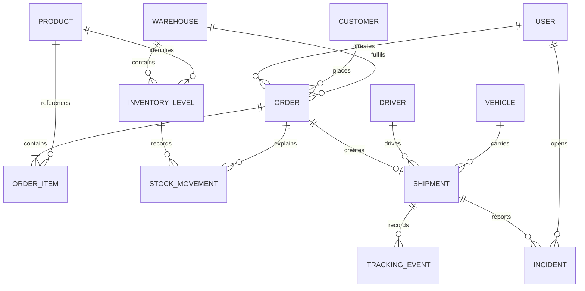

# Data Model

All primary keys are UUIDs. Operational timestamps use `TIMESTAMPTZ`; monetary values use `NUMERIC(12,2)` and weights use `NUMERIC(10,3)`.

## Order snapshots

`Order` stores the shipping name, address, country and coordinates as a snapshot. `OrderItem` stores the product price at draft creation/update. Later changes to a customer or product therefore do not rewrite operational history.

## Inventory invariants

`InventoryLevel` is unique by warehouse and product and carries a JPA `@Version` column. The database enforces:

- `on_hand >= 0`
- `reserved >= 0`
- `reserved <= on_hand`
- `reorder_level >= 0`

Reservations change only `reserved`. Dispatch subtracts the same quantity from `on_hand` and `reserved`. Cancellation releases only the reservation. Each operation creates a movement containing both deltas, the actor, optional order and timestamp.

Movement history is indexed by inventory and timestamp, while workflow lookups are indexed by order and movement type.

## Workflow consistency

An order has at most one shipment. Partial shipments are deliberately outside the current scope. Active shipment assignments have partial unique indexes for driver and vehicle, while services also validate availability and vehicle capacity before assignment. An in-transit shipment must have an assigned driver and vehicle because departure is only exposed through the transactional shipment service.

`delivery_health` is independent of shipment status: a delayed delivery remains `IN_TRANSIT` with health `DELAYED`. Tracking events are append-only from the user interface. Incident resolution records the note and timestamp and can restore delivery health when no other incident remains open.
