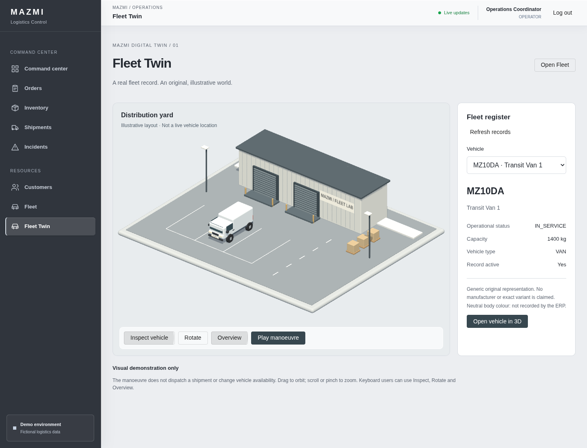

# MAZMI Digital Twin

## World Map — mapa operativo 2D/3D

El dashboard y Shipment Detail incorporan **MAZMI World Map**. El modo inicial es Leaflet; activar 3D carga MapLibre GL JS 6.18.0 y Three.js 0.187.0 bajo demanda, sin cambiar rutas ni permisos. La posición y el zoom se trasladan al cambiar de modo. La inclinación y orientación pertenecen al modo 3D.

Seleccionar un envío desde su marcador o la lista HTML abre su ficha y permite **Focus vehicle**, **Follow vehicle** y **Overview**. Arrastrar, rotar o hacer zoom manualmente cancela el seguimiento. El mapa no se reencuadra por cada actualización. La ficha conserva acceso a Shipment Detail y texto para los tres estados de salud.

### Arquitectura geográfica

- `OperationsWorldMapComponent`: presentación, selección, carga cancelable del motor, errores, recuperación y alternativa 2D.
- `world-map-engine.ts`: MapLibre controla proyección Mercator, cámara, teselas y render; una capa personalizada Three.js comparte su canvas y contexto WebGL2. No hay segundo canvas ni un RAF paralelo.
- `MotionTrack`: interpola únicamente muestras simuladas aceptadas durante 900 ms. Descarta retrocesos de progreso, estados terminales y timestamps antiguos cuando están disponibles. Una respuesta repetida no reinicia el movimiento. Pausa, entrega, pestaña oculta y movimiento reducido ajustan directamente la posición final. El umbral normal de salto es 25 km; con origen/destino verificados y avance de hasta 10 puntos porcentuales se adapta al trayecto, con un máximo de 100 km. Así los ticks interurbanos acelerados del demo pueden interpolarse, pero una posición incompatible salta directamente. No equivale a velocidad física ni a navegación vial.
- `TwinAssets`: reutilizado sin alterar Fleet Twin; geometrías/materiales compartidos por capa y matrículas creadas al cambiar identidades, nunca por frame. Solo `vehicleType=VAN`, ID de vehículo y matrícula verificados habilitan la furgoneta. Otros tipos o asignaciones ausentes conservan marcadores explícitos.
- `DashboardService.MapItem`: ampliación aditiva con vehículo, conductor, estado, ETA, actividad, timestamp y coordenadas origen/destino. `EntityGraph` carga las relaciones en la consulta del dashboard; no hay N+1 HTTP ni migraciones.
- Shipment Detail reutiliza su store y la colección de vehículos ya cargada; no abre otra suscripción STOMP. La reconciliación existente sigue siendo la fuente de datos de la vista.

Los modelos usan metros transformados con `MercatorCoordinate`, con una ayuda visual limitada a 1–4×. A zoom inferior a 16 se muestran marcadores en lugar de furgonetas gigantes. La pintura neutra es una convención visual, no un color almacenado. La identidad del envío nunca se interpreta como identidad del vehículo.

### Cartografía y condiciones

Estilo Positron de [OpenFreeMap](https://openfreemap.org/), configurable mediante `WORLD_MAP_STYLE`. La instancia pública no requiere cuenta, API key ni pago; no tiene SLA y su disponibilidad puede cambiar. Se conservan las atribuciones de OpenMapTiles y OpenStreetMap suministradas por el estilo. Consultar [términos](https://openfreemap.org/tos/) y [licencias](https://github.com/hyperknot/openfreemap/blob/main/LICENSE.md): datos OSM, estilo derivado de Positron y sus respectivas licencias, MapLibre BSD-3-Clause, Three.js MIT.

Solo se solicitan recursos para las vistas utilizadas. No hay precarga masiva ni descarga offline. El proveedor recibe las peticiones cartográficas y la IP del navegador; no recibe credenciales de MAZMI. Sus términos no autorizan scraping o recopilación automatizada general. El workflow comprueba unas vistas concretas de la aplicación, no recopila un catálogo de teselas.

La trayectoria discontinua es ilustrativa, no routing. Los puntos del backend pueden quedar fuera de carreteras o edificios, porque son una simulación. No se añaden alturas de edificios: el estilo contiene huellas cartográficas pero esta entrega no verifica alturas por edificio. La extrusión queda pendiente de una fuente y atributos con procedencia adecuada; no se fabrican volúmenes.

### Recursos y límites

DPR máximo 1.5, dos workers cartográficos, sin postprocesado ni sombras adicionales. Los workers y CSS se sirven desde el mismo despliegue; no dependen de rutas personales ni de un CDN JavaScript. MapLibre gobierna el render; solo se solicita repintado extra mientras hay interpolación. La destrucción elimina mapa, markers, observers, listeners, geometrías, materiales y texturas sin forzar la pérdida del contexto compartido.

La pérdida del contexto o un error de proveedor ofrece **Retry 3D map** y **Use 2D map**. Una lista HTML permite seleccionar envíos sin usar el canvas; el panel móvil se puede plegar. No se afirma rendimiento de 60 FPS ni rendimiento medido en GPU M2. Los eventos actuales de Shipment Detail no incluyen un número de secuencia total: el store rechaza regresiones de progreso, estado y eventos, pero no puede ordenar universalmente dos mensajes contradictorios con igual progreso y sin timestamp.

### Validación reproducible

Tests Vitest de identidad, posiciones inválidas, interpolación, muestras antiguas, pausa, entrega, movimiento reducido, cambio de modo/ruta, carga tardía, errores y limpieza. Tests JUnit del DTO agregado con y sin asignación. El workflow manual **Capture demo screenshots**, opción `world_map_only=true`, levanta el stack real en Ubuntu y ejecuta `capture-world-map.cjs`. Comprueba la identidad HTTP, mensajes STOMP, movimiento visual, cambio 2D/3D, seguimiento, móvil y recuperación de contexto; guarda capturas y un informe JSON como artifact.

## Fleet Twin — primera entrega

Ruta autenticada: `/digital-twin`. Lectura de `/api/v1/vehicles` con los permisos existentes. No hay nuevas tablas, mutaciones ni reglas de negocio.

## Uso

Seleccionar un vehículo y pulsar **Open vehicle in 3D**. Las furgonetas tienen una representación genérica original, con su matrícula real dibujada en una textura Canvas. Otros tipos conservan una ficha HTML sin asignarles una silueta incorrecta. Inspect, Rotate y Overview permiten explorar sin arrastrar el ratón. La maniobra es una demostración visual que puede pausarse, no telemetría ni una acción de expedición.

## Capturas

[Vista móvil completa](screenshots/fleet-twin-mobile.png)

## Arquitectura

- `FleetTwinStore`: consulta HTTP cancelable, selección y recuperación de errores; alcance local.
- `vehicle-twin.ts`: adaptación explícita del contrato Vehicle. Sin inferir fabricante, variante o color a partir de texto libre.
- `FleetScene`: renderer, cámara ortográfica, OrbitControls, raycasting, reloj único y trayectoria. Render bajo demanda; RAF solo durante movimiento o enfoque. Suspensión en pestaña oculta.
- `TwinAssets`: catálogo por escena, geometrías y materiales compartidos, texturas de matrícula limitadas y liberación idempotente.
- `DigitalTwinPage`: interfaz accesible, carga dinámica del motor, protección frente a cargas obsoletas, fallback y reconstrucción tras pérdida de contexto.

Three.js se importa al abrir el visor, no en las rutas existentes. Resolución limitada a DPR 1.5 y sombras de 1024 px. Sin postprocesado ni assets remotos. No se aplica LOD a esta escena pequeña.

## Assets y licencias

La furgoneta, nave, muelles, señalización y cajas son geometrías procedurales originales del repositorio, sujetas a su LICENSE. No representan modelos comerciales verificados. Three.js y sus addons: MIT; @types/three: MIT. No se redistribuyen modelos externos ni se requiere ninguna descarga de assets.

## Límites explícitos

El patio no reproduce instalaciones reales. Las cajas no equivalen a unidades de inventario. El color neutro no procede del registro: el contrato no contiene color. No hay configuración persistente de pintura, fabricante o asset. No se pretende que un modelo genérico sea una Transit o Sprinter exacta. La ficha se actualiza al solicitar Refresh, no mediante telemetría en vivo. No se enlaza un envío concreto sin consultar su asignación real.

WebGL2 es necesario para el visor; la ficha y el enlace Fleet funcionan sin él. La preferencia de movimiento reducido desactiva la maniobra. La validación gráfica automatizada usa Chromium/SwiftShader en Ubuntu, no certifica rendimiento de GPU ni gestos en dispositivos físicos.

## Validación reproducible

Los comandos frontend del README incluyen las pruebas del adaptador, selección, cancelación, errores y recursos compartidos. El workflow manual `Capture demo screenshots` arranca PostgreSQL, backend y frontend reales y ejecuta `capture-twin.cjs`: ficha vinculada, escritorio, móvil, controles, movimiento reducido y pérdida/recuperación de contexto. Produce `fleet-twin.png` y `fleet-twin-mobile.png` como artifacts.

## Próximas fases

1. World Map: edificios solo con alturas verificables; rutas de carretera únicamente con geometría de procedencia conocida, separadas del tracking simulado.
2. Warehouse Twin: introducir ubicaciones y muelles persistentes únicamente tras definir su correspondencia con inventario; migraciones aditivas, no coordenadas ficticias.
3. Control Room: escenas compartiendo catálogo y adaptadores, con paneles reales.
4. Editor: esquema espacial versionado, permisos, presupuesto de assets y optimización medida.

Los futuros campos de vehículo (fabricante, variante, año, color, asset y grado de fidelidad) deben ser opcionales y validados; un catálogo autorizado limitará las partes pintables. Esta entrega no necesita ampliar el DTO.
