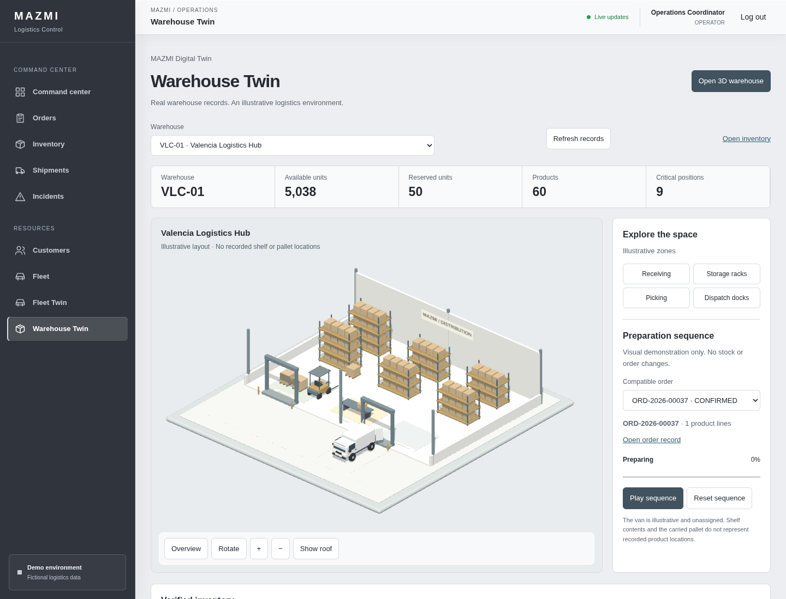

# MAZMI Warehouse Twin

La ruta autenticada `/warehouse-twin` permite explorar una nave industrial isométrica, consultar inventario real por almacén y reproducir una secuencia logística ilustrativa. No cambia stock, pedidos ni asignaciones de flota.

## Plano del editor

Al abrir la escena se consulta la revisión guardada. Si no hay plano se mantiene la maqueta original. Con plano se reemplazan los objetos, sin superponer las dos distribuciones. Un pasillo lateral recto requiere recepción, muelle orientado hacia la salida y espacio libre para palé, carretilla y furgoneta. Si no existe se conserva la exploración estática y se explica el motivo. No se calcula una ruta física real.

## Registros y geometría

- El selector usa `GET /api/v1/warehouses`.
- Las existencias proceden de `GET /api/v1/inventory?warehouse={id}`. Los indicadores suman disponibilidad y reservas, cuentan productos distintos y posiciones cuya disponibilidad no supera su umbral de reposición.
- La carga recorre páginas de 100 posiciones hasta un máximo de 2.000. Si la colección supera ese límite, la interfaz indica que las métricas cubren únicamente las posiciones cargadas.
- Se ofrecen hasta 20 pedidos confirmados y 20 en preparación del almacén. Antes de habilitar la secuencia se consulta el detalle y se verifica su almacén, estado e items.
- Las estanterías, palés, muelles y cantidades de cajas son geometría determinista ilustrativa: no existen correspondencias persistidas entre productos y ubicaciones interiores. Seleccionar una zona explica este límite; no asigna productos a estantes inventados.
- La furgoneta de carga es ilustrativa, sin asignación de flota. Su rótulo `VISUAL` no representa una matrícula registrada.

## Explorar y reproducir

1. Elegir un almacén y pulsar **Open 3D warehouse**.
2. Orbitar, ampliar o seleccionar una zona. Los botones de zona también funcionan con teclado. **Overview** recupera la vista general; la cubierta se puede mostrar u ocultar.
3. Seleccionar un pedido compatible y pulsar **Play sequence**.
4. Observar preparación, recogida de palé, traslado de carretilla, aproximación al muelle y carga ilustrativa en la furgoneta.
5. Pausar, reanudar o reiniciar. Cambiar de pedido reinicia la secuencia; cambiar de almacén destruye la escena anterior.

La secuencia tiene 24 segundos de tiempo visual y puede avanzar más despacio en renderizadores limitados. No representa una duración operativa medida. Se pausa al ocultar la pestaña. Con movimiento reducido se ofrece exploración estática, sin reproducción automática.

## Arquitectura y recursos

- `WarehouseTwinStore`: estado local, consultas cancelables mediante `rxMethod`/`switchMap`, carga paginada, errores independientes de inventario y pedidos y comprobación de pertenencia al almacén.
- `warehouse-model.ts`: métricas, zonas y reloj determinista de animación, sin acceso a API ni motor gráfico.
- `WarehouseScene`: cámara ortográfica, OrbitControls, raycasting, foco, una única fuente de tiempo y ciclo de vida WebGL. Se importa al abrir la escena, no al arrancar el ERP.
- `WarehouseAssets`: composición propia de nave, racks y carretilla. Reutiliza `TwinAssets`, sus geometrías/materiales y la furgoneta de Fleet. Las cajas repetidas usan `InstancedMesh`.
- Resolución limitada a DPR 1,5 en escritorio y 1,25 en vistas estrechas; sombras de 1.024 px, sin postprocesado. No hay render continuo en reposo. Se liberan geometrías, materiales, texturas, controles, listeners y renderer al salir.
- Si WebGL falla, los registros HTML siguen disponibles. La pérdida de contexto ofrece reconstrucción explícita de la escena.

Los assets procedurales son originales del proyecto y están sujetos a su [licencia](../LICENSE). Three.js utiliza licencia MIT. No se han añadido modelos comerciales, texturas externas ni dependencias nuevas. No hay cambios de backend o migraciones.

## Validación reproducible

Las pruebas frontend cubren consultas, cancelación, paginación, errores, selección de registros, compatibilidad, secuencia y liberación de recursos. Se ejecutan con los comandos habituales de `frontend/package.json`.

El workflow manual **Capture demo screenshots**, con `warehouse_only=true`, levanta PostgreSQL, Spring Boot y Angular con datos demo en Ubuntu. `.github/scripts/capture-warehouse.cjs` valida el flujo con Chromium, comprueba que no se envían mutaciones al ERP y genera cinco PNG y un informe JSON como artifact. No utiliza mocks para las capturas.

La [ejecución gráfica 43388691998](https://github.com/LucaMZM/mazmi-logistics-control/actions/runs/43388691998) verificó con Chromium 141 el almacén `VLC-01` y el pedido demo `ORD-2026-00037`: métricas contrastadas con la API, selección por raycasting y teclado, cubierta, secuencia completa, pausa/reanudación/reinicio, pérdida y recuperación WebGL, movimiento reducido y navegación de vuelta al ERP. El pedido y las existencias no cambiaron; no hubo escrituras API ni errores JavaScript capturados.

El [CI de la implementación](https://github.com/LucaMZM/mazmi-logistics-control/actions/runs/43388699233) pasó formato, lint, typecheck, 81 tests frontend, build y 57 tests backend, sin omitidos. Se mantuvieron los umbrales de build: hay advertencias de tamaño de bundles/estilos y CommonJS, no errores. La creación del cliente STOMP usa un punto de inyección para que sus seis tests no dependan del mock de módulos; su configuración y protocolo no cambian.

## Capturas reales

Escritorio de 1.440 × 1.100 px; vista móvil de 390 × 844 px capturada a página completa.

- [Estanterías seleccionadas](screenshots/warehouse-storage.png)
- [Carretilla durante el traslado](screenshots/warehouse-manoeuvre.png)
- [Muelles tras completar la secuencia](screenshots/warehouse-dispatch.png)
- [Vista móvil con movimiento reducido](screenshots/warehouse-mobile.png)

## Límites y continuidad

No es un plano digital del edificio real ni telemetría de carretillas. La primera versión no incorpora ubicaciones físicas persistentes, reservas de muelles, picking por estante ni asignaciones nuevas. El rendimiento de un runner con SwiftShader no equivale a una medición en un MacBook Air M2.

Una evolución posterior puede añadir zonas y ubicaciones persistidas con relaciones verificables, reutilizando este catálogo y el ciclo de vida de escena. Control Room y el editor de almacenes quedan fuera de esta entrega.
